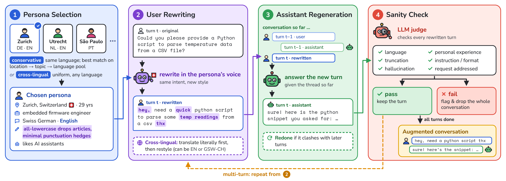

# PersonaFactory: Stylistic User Prompt Augmentation with Synthetic Persona Bank

[](#citation)
[](https://swiss-ai.github.io/personafactory/)
[](https://huggingface.co/datasets/swiss-ai/PersonaFactory)
[](LICENSE)

This repository contains the official implementation of *"PersonaFactory: Stylistic User Prompt Augmentation with Synthetic Persona Bank"*. The interactive project page is at [swiss-ai.github.io/personafactory](https://swiss-ai.github.io/personafactory/).

## Authors

[Bich Ngoc Doan](https://ngoccc.github.io/)\* | [Hanna Yukhymenko](https://www.ayukh.com/)\* | [Imanol Schlag](https://ischlag.github.io/)

\* Equal contribution.

## Abstract

Large language models increasingly replace real people in the AI development pipeline, as they are used to generate training dialogues at scale and to drive alignment and evaluation. However, out-of-the-box models produce monolingual and stylistically flat texts as synthetic user prompts, failing to replicate the real user-AI communication mechanics. We present PersonaFactory, an end-to-end pipeline that generates detailed user personas and uses them to augment existing user prompts from their point of view, producing a bank of over 740,000 structured synthetic personas detailing their background and communication behaviors, and a corpus of roughly 1.24 million persona-styled synthetic conversations spanning 85 languages. We evaluate the effect of personal features on style adoption and intent preservation, using an LLM-judge and heuristic metrics to assess augmentation fidelity together with the downstream impact on assistant persona control through training data. Results show that our structured, attribute-based style representation enables per-axis control and better intent preservation at comparable style fidelity than free-text persona descriptions used in existing methods. A human expert evaluation found the augmented conversations plausible, with favorable ratings for intent preservation, style naturalness, and multilingual authenticity. Finally, PersonaFactory conversations achieve comparable performance to original training data on capability benchmarks, are preferred on real user prompts at equal reply length, and adapt their reply style more closely to users without explicit steering.

## Overview

PersonaFactory builds a bank of structured synthetic user personas and uses it to re-voice the user side of real chat logs, keeping every request and the dialogue trajectory fixed:



Each persona has a **background** layer (who the person is: location, occupation, education, age, languages, attitude towards AI, digital fluency) and a **style** layer (how they type to a chatbot: capitalization, punctuation, emoji, abbreviations, typos, code-switching, quirks and an example message). For every seed conversation the pipeline selects a persona, rewrites each user turn in that persona's voice (with quoted text, code and numbers protected), regenerates the assistant turn for that user, checks that the answer still leads to the next original user turn, and passes every turn through an LLM sanity judge. The repository covers five parts that can be used separately:

* **Persona bank**: generate profiles with three open models on a country, sub-region and occupation grid, judge and repair them, filter for diversity, and extend existing persona sets (e.g. Nemotron-Personas, PersonaHub) with a style layer.
* **Augmentation**: prepare seed conversations (WildChat, UltraChat, Nemotron Instruction-Following Chat), match personas in the language-matched or cross-lingual setting, rewrite user turns and regenerate assistant turns, optionally with an assistant response style (model persona).
* **Post-processing and release**: quality filters and regenerations on the merged corpus, corpus statistics, and the Hugging Face export.
* **Evaluation**: corpus-scale LLM judge and judge-free fidelity metrics, structured versus flat style representation, per-attribute ablation, persona-format comparison, style extension A/B.
* **Training**: assistant-side SFT ablation and downstream fine-tuning of Apertus-v1.5-8B on the released conversations.

**Released data**: 743,010 personas from 177 countries and 599 sub-regions; 1,242,761 conversations in 85 languages ([swiss-ai/PersonaFactory](https://huggingface.co/datasets/swiss-ai/PersonaFactory))

**Model serving**: any OpenAI-compatible endpoint (vLLM, SGLang, hosted APIs); endpoint arguments accept one base URL or a comma-separated list of replicas

---

## Installation

Python 3.10 or later (tested with 3.12).

```bash
git clone https://github.com/swiss-ai/personafactory.git
cd personafactory
pip install -r requirements.txt          # pipeline clients, post-processing, release build, evaluation, figures
pip install -r requirements-gpu.txt      # model serving (vLLM, SGLang), SFT ablation, lm-evaluation-harness
cp configs/.env.example .env             # paths and endpoints; every value can also be passed on the command line
```

Run everything from the repository root (or add it to `PYTHONPATH`). Every module runs as `python -m personafactory.<module>` and has `--help`. Language identification needs the fastText model [`lid.176.ftz`](https://fasttext.cc/docs/en/language-identification.html) (`PF_LID_MODEL`). API keys are read from `PF_API_KEY` / `OPENAI_API_KEY` (a local server accepts any value). The Apertus fine-tuning runs use Megatron-LM with Apertus support, which is not pip-installable; see `personafactory/downstream/README.md`.

---

## Quick Start

### Inspect the data

```python
from datasets import load_dataset

chats = load_dataset("swiss-ai/PersonaFactory", "chats", split="train")
bank = load_dataset("swiss-ai/PersonaFactory", "persona_bank", split="train")
```

`data/sample/` holds 340 conversations (all 85 languages plus the label for turns too short to detect, every seed source, setting and responder) and their 335 personas in the released schema, and `docs/DATA.md` describes all fields.

### Augment conversations

The generation stages are clients of three served models: a rewriter / responder (`google/gemma-4-31B-it`, and `mistralai/Ministral-3-14B-Instruct-2512` as second responder) and a judge (`MiniMaxAI/MiniMax-M2.5`). `scripts/slurm/serve_models.sh` starts them inside an allocation and exports their URLs. With the released bank as `PF_BANK` and seed shards from `augmentation.prepare_seeds`:

```bash
export PF_BANK=./data/persona_bank.jsonl PF_LID_MODEL=./data/lid.176.ftz
python -m personafactory.augmentation.embed_personas --bank $PF_BANK --seeds-dir ./data/seeds/shards --out-dir ./outputs/assign
python -m personafactory.augmentation.select_personas --bank $PF_BANK --seeds-dir ./data/seeds/shards --out-dir ./outputs/assign --cap 40
source scripts/slurm/serve_models.sh gemma ministral judge          # inside a 2-node allocation
for mode in free multilingual; do
  python -m personafactory.augmentation.run_augmentation --input-kind seeds --pairs ./data/seeds/shards/$mode-*.jsonl \
      --mode $mode --assign-dir ./outputs/assign --outdir ./outputs/run/gen --bank $PF_BANK --lid-model $PF_LID_MODEL \
      --gemma $GEMMA_URL --ministral $MINISTRAL_URL --minimax $JUDGE_URL
done
python -m personafactory.augmentation.build_corpus --stage user --run ./outputs/run
python -m personafactory.augmentation.build_corpus --stage final --run ./outputs/run
```

`free` is the language-matched setting and `multilingual` the cross-lingual one (translate, then restyle). For datasets without user personas, `personafactory/assistant/` regenerates only the assistant side with a matched response style.

---

## Repository Structure

```
personafactory/
  persona_bank/     persona generation (base and extended location grids), schema, judge validation with repair,
                    diversity filter, emoji rebalancing, bank assembly, style extension of external persona sets
  augmentation/     seed preparation, persona embedding and selection, the pipeline core (rewrite, translate-then-
                    restyle, assistant regeneration, continuity loop, sanity gate), generation driver, corpus records
  assistant/        12 assistant response styles (model personas), style matching, regeneration, leak filter,
                    assistant-only mode, model-persona pilots
  postprocess/      quality stages on the merged corpus: low-resource filter and regeneration, assistant
                    regeneration, low-script drop, language caps, judge sample, corpus statistics
  release/          release build, merge, emoji scrub, assistant swap, corpus statistics, Hugging Face build and upload
  evaluation/       corpus judge and fidelity metrics, structured vs flat style, attribute ablation and judge
                    agreement, persona-format comparison, style extension A/B
  downstream/       arm construction (A0, A0r, A1, A2, X1, X2), Megatron-LM data preparation, perturbation and
                    WildChat pairwise evaluation, reports
  sft_ablation/     assistant-side SFT ablation (TRL and Megatron-LM)
  figures/          scripts for every data figure in the paper
  common/           judge client, language identification, canonical language labels
configs/            environment template (.env.example)
data/sample/        small sample of the released data
docs/DATA.md        released schema and working-directory layout
scripts/examples/   end-to-end commands per part, with the released settings
scripts/slurm/      generic Slurm templates (no cluster-specific settings) and model serving
assets/             README figures
site/               project page (static; `python3 site/build.py`), deployed to GitHub Pages by .github/workflows/pages.yml
```

Each subpackage has its own README with inputs, outputs, settings and commands.

---

## End-to-End Pipeline

Set `PF_DATA_DIR` (inputs) and `PF_OUT_DIR` (outputs); see `configs/.env.example` and `docs/DATA.md`. Cluster flags for the Slurm templates go into `SBATCH_ARGS` (or the `sbatch` command line), containers into `SRUN_ARGS` / `PF_SRUN_ARGS`, environment activation into `ENV_SETUP`. The example scripts reproduce the release with its exact settings (shards, seeds, temperatures, thresholds, models per stage).

1. **Persona bank.** `scripts/examples/persona_bank.sh`: generation with three models on the base grid (201 locations) and the extended grid (599 locations in 177 countries), MiniMax-M2.5 judge with repair, diversity filter, emoji rebalancing, assembly of the 743,010-profile bank (`personafactory/persona_bank/README.md`).
2. **Conversations.** The corpus combines two seed sets that run through the same pipeline core: persona pairs (one UltraChat or Nemotron seed per persona, both settings; `personafactory/augmentation/README.md`, `personafactory/assistant/README.md`) and a seed pool (WildChat, UltraChat and Nemotron seeds, at most 40 language-matched seeds per persona). `scripts/examples/corpus.sh` runs seed preparation, assignment, generation, record building and the merge.
3. **Post-processing.** `scripts/examples/corpus.sh` (steps 7 to 15): low-resource quality filter and Gemma regeneration, Gemma assistant regeneration for cross-lingual conversations answered by Ministral, low-script drop, language caps, judge sample and statistics (`personafactory/postprocess/README.md`).
4. **Release.** `scripts/examples/release_hf.sh`: corpus statistics, parquet shards and the dataset card (`personafactory/release/README.md`).
5. **Evaluation.** `scripts/examples/evaluation.sh` (corpus judge, full-corpus fidelity table, corpus-wide judge estimate), `scripts/examples/style_extension.sh`, and the studies in `personafactory/evaluation/README.md`.
6. **Training.** `scripts/examples/downstream.sh` (downstream fine-tuning and evaluation, `personafactory/downstream/README.md`) and `personafactory/sft_ablation/README.md`.

---

## Models

Default models per role (configurable on every CLI):

| Role | Model |
|---|---|
| Persona generators | `google/gemma-4-31B-it`, `mistralai/Ministral-3-14B-Instruct-2512`, `zai-org/GLM-4.7-Flash` |
| Persona judge, continuity and sanity judge, corpus judge | `MiniMaxAI/MiniMax-M2.5` |
| User rewriting and translation | `google/gemma-4-31B-it` or `mistralai/Ministral-3-14B-Instruct-2512` (the conversation's responder; translation with Gemma) |
| Responders | `google/gemma-4-31B-it`, `mistralai/Ministral-3-14B-Instruct-2512` (50/50 per conversation) |
| Persona matching | `sentence-transformers/all-MiniLM-L6-v2` |
| Fidelity | `sentence-transformers/LaBSE` |
| External judges (style A/B, downstream WildChat comparison) | `Qwen/Qwen3.6-35B-A3B-FP8`, `meta-models/Muse-Glimmer-30B` |

`scripts/slurm/serve_models.sh` starts the generation models (vLLM for Gemma and Ministral, SGLang for MiniMax-M2.5) and exports their URLs.

---

## Responsible Use

The personas are synthetic and do not describe real people, and the bank is not a representative sample of any population. Seed conversations come from public chat datasets and keep their content, including requests some users may find offensive; follow the licenses and terms of the seed datasets (WildChat, UltraChat, Nemotron Instruction-Following Chat) when you use the corpus. Do not use the personas or the pipeline to impersonate real individuals or to produce deceptive content.

## License

The code is released under the [MIT License](LICENSE). The dataset is released under Apache 2.0 (see the [dataset card](https://huggingface.co/datasets/swiss-ai/PersonaFactory)). The files in `data/sample/` are a sample of that dataset and follow its license; text that comes from the seed conversations stays under the seed datasets' terms.

## Citation

```bibtex
@misc{doan2026personafactory,
      title={PersonaFactory: Stylistic User Prompt Augmentation with Synthetic Persona Bank},
      author={Bich Ngoc Doan and Hanna Yukhymenko and Imanol Schlag},
      year={2026},
}
```
